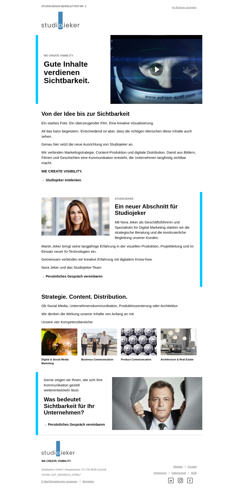
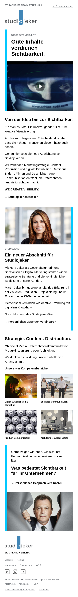

# Studiojeker Newsletter 02 – Visibility

**Interner Kampagnenname:** Studiojeker Newsletter 02 – Visibility  
**Betreff (in Mailchimp setzen):** Gute Inhalte verdienen Sichtbarkeit.  
**Preheader:** Warum gute Bilder allein nicht genügen – und was Studiojeker heute anders macht.  
**Absender:** Nora Jeker und das Studiojeker-Team

## Datei und verbindliche Referenz

- Versand-HTML: [studiojeker-newsletter-02-visibility.html](studiojeker-newsletter-02-visibility.html)
- Unveränderte V7-Kopie: [reference/studiojeker-newsletter-v7.html](reference/studiojeker-newsletter-v7.html)
- Quelle aus PR #130: https://raw.githubusercontent.com/mjeker99-collab/studiojeker-website/gh-pages/v7-corrections/studiojeker-newsletter-v7.html
- Git-Blob-SHA der Quelle und der gespeicherten Referenz: `cd952f3fb0c95a9875c3d7dcf24274e7838b2161`.

V7 auf `gh-pages` wurde nicht verändert. Die vorhandene lokale Newsletter-Vorlage wurde ebenfalls nicht verändert. Sämtliche hinzugefügten Dateien liegen unter `mailchimp/`.

## Vorschauen und Vergleich

| Ansicht | V7 | Newsletter 02 |
| --- | --- | --- |
| Desktop, 1000 px Browserbreite | [V7 Desktop](previews/v7-desktop.png) | [Visibility Desktop](previews/visibility-desktop.png) |
| Mobile, 390 px Browserbreite | [V7 Mobile](previews/v7-mobile.png) | [Visibility Mobile](previews/visibility-mobile.png) |

## Redaktionelle Zuordnung

- Hero: neue Headline; der bestehende Eyebrow enthält `WE CREATE VISIBILITY.`. Desktop-/Mobile-Helmbild mit Playbutton; der Link führt zum Showreel-Abschnitt der Startseite.
- Einleitung: Einleitungstext und „Von der Idee bis zur Sichtbarkeit“ im bestehenden Block mit vier Absätzen. CTA: „Studiojeker entdecken“.
- Bisheriger AI-Block: „Ein neuer Abschnitt für Studiojeker“, Nora-Portrait, Nora-/Martin-Text, gemeinsamer Anspruch und Absender. Der vorhandene CTA führt zum persönlichen Gespräch.
- Kompetenzblock: „Strategie. Content. Distribution.“ und die vier Kompetenzbilder mit unveränderten Kompetenzlinks. Product, Business und Architecture verwenden die neu bereitgestellten Originalmotive; Digital bleibt unverändert.
- Kontaktblock: gewünschte Frage, Einladung und Gesprächs-CTA. Die in V7 vorhandene Reihenfolge Text vor Headline bleibt erhalten.
- Footer: vollständig unverändert.

Noras verbindliches Originalportrait ist jetzt die neu hochgeladene `Foto 1.jpg`. `assets/nora-jeker-visibility.jpg` ist eine bytegleiche Kopie, ohne Bildbearbeitung oder zusätzlichen Beschnitt. Es wird über eine commitgebundene HTTPS-URL aus dem Repository ausgeliefert. Kein Personenbild wurde generiert. Ein gemeinsames Nora-/Martin-Portrait wurde nicht benötigt: Der vorhandene Bildplatz zeigt Nora; beide Rollen sind im Text beschrieben.

## Prüfresultate am 13. Oktober 2026

`python mailchimp/verify-visibility.py` bestätigt:

- Gleiche Tagfolge, Verschachtelung und Modulanzahl.
- CSS-Blöcke und sämtliche Inline-Styles identisch.
- Alle geschützten Attribute identisch, einschliesslich Breiten, Höhen, Klassen, Tabellenattribute und Mailchimp-Editierregionen.
- Outlook-Kommentare, responsive Einstellungen, Cyan-Balken, Logos und Footer unverändert.
- Mailchimp-Merge-Tags identisch: `*|ARCHIVE|*`, `*|HTML:LIST_ADDRESS_HTML|*`, `*|UPDATE_PROFILE|*`, `*|UNSUB|*`.

Gegenüber V7 wurden ausschliesslich redaktionelle Texte, redaktionelle Bild-URLs/ALT-Texte und redaktionelle Links samt zugänglicher Hero-Linkbeschreibung geändert. Die anschliessenden Bildkorrekturen ändern nur Bild-URLs, ALT-Texte sowie das Hero-Linkziel mit seiner zugänglichen Beschreibung. Sämtliche redaktionellen Texte bleiben identisch. Kein Layout-, CSS- oder Strukturunterschied. Die Gesamthöhe und Textumbrüche ergeben sich wie in V7 automatisch aus dem neuen Inhalt. Das neue Nora-Foto (1280 × 720) hat dasselbe Seitenverhältnis wie das zuvor verwendete Nora-Foto (1920 × 1080). Die HTML-Bilddimensionen und `height:auto` bleiben unverändert.

Chromium-Prüfung: V7 und Visibility bei 1000, 390 und 320 px ohne horizontalen Überlauf; alle Bilder geladen. Der Desktop-/Mobile-Hero schaltet unverändert bei 480 px. Einzelwerte: [visibility-responsive-checks.json](visibility-responsive-checks.json).

Alle 33 geprüften HTTPS-Ziele antworteten mit HTTP 200, einschliesslich sämtlicher Bilder, Kompetenzlinks, Footerlinks, Social-Media-Ziele und Showreel. `/contact` leitet auf `/contact/` weiter. Ergebnisse und Bildprüfsummen: [visibility-url-checks.json](visibility-url-checks.json).

`git diff --check` bestanden. Website-Lint, Typecheck und Build wurden versucht, sind aber mangels installierter Projektabhängigkeiten (`eslint`, `tsc`, `next`) nicht ausführbar. Es gibt kein `test`-Skript im Projekt. Die Newsletter-Datei benötigt diese Website-Werkzeuge nicht.

## Aktualisierung des Nora-Portraits

Das neu hochgeladene Portrait ersetzt das vorherige Foto ausschliesslich im bestehenden Teamabschnitt. Desktop- und Mobile-Vorschau sowie URL-Prüfprotokoll wurden neu erstellt. Texte, ALT-Text, Layout, Bildcontainer, Position, CSS, Schriftgrössen, Abstände, Cyan-Balken, Spaltenstruktur, Footer und Mailchimp-Tags bleiben unverändert.

## Weitere Bildkorrekturen

- Hero: das bereitgestellte Helmbild, auf dieselben Desktop-/Mobile-Exportdimensionen wie V7 zugeschnitten (1040 × 780 / 800 × 600), mit eingebranntem Playbutton. Link: `https://www.studiojeker.ch/#home-showreel-title`. Der Anker ist auf der erreichbaren Startseite vorhanden.
- Kontakt: das bisherige Businessportrait des Mannes aus `public/images/business/14A1361.jpg`, im bisherigen Kontakt-Bildformat exportiert (760 × 446).
- Product: `CM8A1500-scaled.jpg`; Business: `Werbefotografie01.jpg`; Architecture: `3D_3.jpg`. Jeweils Originalfoto auf 600 × 450 für die unveränderten Kompetenzbildplätze zugeschnitten.
- Nora: weiterhin ausschliesslich das verbindliche neue Portrait. Digital: unverändert.
- Bearbeitung der verwendeten Bilder: mechanischer Zuschnitt und Skalierung der Originale; beim Hero zusätzlich ein Play-Symbol. Keine generierten Personenbilder eingesetzt. Die vier zuletzt bereitgestellten Originaldateien liegen bytegleich unter `assets/*-original.jpg`.
- HTML-Struktur, CSS, Bildattribute, Texte, Spalten, Balken, Footer und Merge-Tags unverändert. Aktualisierte Vorschauen und URL-/Responsive-Protokolle liegen bei.

## Vor dem Versand

Die Mailchimp-Tags sind unverändert vorhanden; ihre Auflösung und der Abmeldevorgang können erst in einer tatsächlichen Mailchimp-Kampagne geprüft werden. Chromium-Vorschauen ersetzen keine Testsendung in Outlook, Gmail und Apple Mail. Betreff und internen Namen beim Import in Mailchimp setzen und eine Testsendung durchführen. Dieser PR versendet keinen Newsletter und wird nicht automatisch gemergt.
